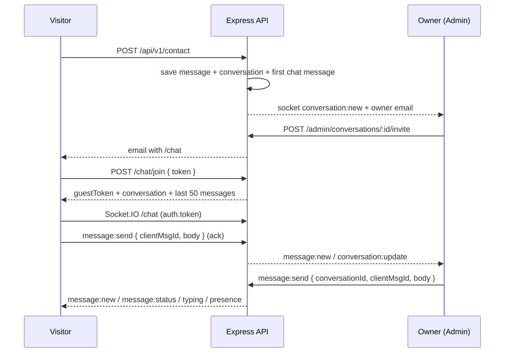

# Software Portfolio — Public Site, Admin Console & API

A full-stack personal portfolio for **Adetoye Daniel Kehinde**: a public Next.js
site, a private single-owner admin console, and an Express/PostgreSQL API that
serves both, including a verified live-chat system with email invites and
real-time messaging.

The site is content-managed, not hard-coded: everything the public site renders
(hero, about, projects, experience, skills, security notes, credentials, resume,
contact details) is stored in PostgreSQL and edited from the admin console, with
cache revalidation so changes appear within seconds.

---

## Table of contents

1. [What this is](#what-this-is)
2. [The three applications](#the-three-applications)
3. [Feature overview](#feature-overview)
4. [Tech stack](#tech-stack)
5. [Architecture](#architecture)
6. [Authentication and session model](#authentication-and-session-model)
7. [Live chat](#live-chat)
8. [Error handling and resilience](#error-handling-and-resilience)
9. [Repository layout](#repository-layout)
10. [Data model](#data-model)
11. [API surface](#api-surface)
12. [Getting started](#getting-started)
13. [Environment variables](#environment-variables)
14. [Database workflow](#database-workflow)
15. [Scripts](#scripts)
16. [Testing and verification](#testing-and-verification)
17. [Deployment topology](#deployment-topology)
18. [Design decisions and trade-offs (analysis)](#design-decisions-and-trade-offs-analysis)
19. [Known limitations and roadmap](#known-limitations-and-roadmap)
20. [Troubleshooting](#troubleshooting)
21. [Documentation index](#documentation-index)

---

## What this is

| Surface | URL (local) | Who uses it | What it does |
|---|---|---|---|
| **Public site** (`client/`) | `http://localhost:3000` | Visitors | Portfolio, projects, resume download, contact form, invite-only live chat |
| **Admin console** (`admin/`) | `http://localhost:5173` | The owner | Content CRUD, inbox/live chat, resume + media management, 2FA, sessions, audit log |
| **API** (`backend/`) | `http://localhost:8080` (docs use 8000) | Both frontends | REST + Socket.IO, auth/2FA, storage signing, email, jobs |

**Core idea:** the API is the single source of truth and the only security
boundary. The admin console holds no secrets and no server logic; it is a pure
client of the authenticated API. The public site renders from one aggregate
read (`GET /api/v1/site`) so the landing page never depends on many sequential
requests.

---

## The three applications

### 1. Public site — `client/` (Next.js 16, App Router)

- Server components fetch `GET /api/v1/site` with ISR (`revalidate: 60`, tag
  `site`, 5 s timeout) and fall back to static defaults when a section is
  missing, so the landing page still renders during an API outage.
- A per-request Redux store (`siteSlice` + `publicApi` RTK Query) feeds client
  sections; a refresh component re-fetches on focus/reconnect at most once a
  minute and only replaces state when `generatedAt` is newer.
- Contact form: hidden honeypot, mirrored client-side validation, field-level
  server errors, duplicate/rate-limit/network copy. Submitting creates a
  conversation in the admin inbox; the visitor is never auto-emailed.
- `/chat` is an isolated route with its own layout and store: invite token
  exchanged from the URL **fragment**, guest token kept in `sessionStorage`,
  Socket.IO with REST + polling fallback, typing/presence/read receipts,
  optimistic sends, and offline/reconnect handling. `noindex`.
- Offline handling: a site-wide status banner (root layout) plus a chat
  connection strip, with refetch/catch-up when the browser comes back online.

### 2. Admin console — `admin/` (React 19 + Vite)

- Redux Toolkit + RTK Query with a single base query that handles CSRF retry,
  transparent session refresh and the 401 sign-in flow (never signs out on
  503/network failures).
- Pages: dashboard, inbox (thread view), projects (editor + gallery reorder),
  hero, about, experience, skills, security (focus/OWASP/stats), credentials,
  resume, settings, account (2FA, recovery codes, sessions), activity (audit).
- Drag-and-drop ordering, optimistic updates with rollback, uploads signed by
  the API and sent straight to Cloudinary, validation via react-hook-form + Zod.
- Tokens never touch JavaScript: the session is an `httpOnly` cookie, the CSRF
  token is memory-only and re-fetched on demand.

### 3. API — `backend/` (Express 5 + Drizzle)

Layered as `routes → controllers → services → repositories → Drizzle/Postgres`,
with Zod schemas at the edges, a central error handler, pino logging with
redaction, Socket.IO namespaces, background jobs and storage drivers.

---

## Feature overview

**Portfolio**
- Content-managed hero, about, credentials, skills, experience, security and
  project case studies with galleries and optional PDF attachments.
- Featured project (enforced single row with a partial unique index) and
  drag-and-drop ordering.
- Resume upload/replacement, metadata, download counter and cache-busted links.
- Contact form with spam controls (honeypot, duplicate hash, rate limiting) that
  opens a chat conversation.
- SSE content-update stream with a polling fallback (`/api/events`,
  `/api/content-version`) and an ISR revalidation webhook on admin mutations.

**Admin**
- Password + optional TOTP 2FA (QR provisioning, 10 single-use recovery codes).
- Session management: list/revoke sessions, revoke all others, password change
  that invalidates every session.
- Audit log for every mutation; request-scoped user id and IP hash.
- Media pipeline: signed direct uploads, image re-encoding, orphan cleanup,
  delete protection for files still attached to content.
- Inbox: filters (status/starred/spam/unread/search), unread counters, invites,
  typing indicators, read receipts, spam/close/delete.

**Chat**
- Invite-only: 32-byte token, only its SHA-256 hash stored, 7-day lifetime, one
  click rotates/revokes.
- Email OTP verification (6 digits, HMAC-hashed, attempts + expiry) before a
  guest token is issued.
- Idempotent sends via `clientMsgId`; delivery/read state; per-socket token
  buckets; rate limits on every endpoint.
- Throttled transactional email for new conversations, offline replies and
  invites; mail failure never fails a request.
- Housekeeping: idle conversations auto-close at 30 days, closed ones are
  deleted at 90 days.

---

## Tech stack

| Layer | Technology |
|---|---|
| **Public site** | Next.js 16 (App Router, RSC, ISR), React 19, TypeScript, Tailwind CSS 4, Redux Toolkit + RTK Query, Socket.IO client, Framer Motion, Lucide, react-icons, pnpm |
| **Admin** | React 19, Vite 8, TypeScript 6, Redux Toolkit + RTK Query, React Router 7, Tailwind CSS 4, react-hook-form + Zod, Sonner, Lucide, dnd-kit, socket.io-client, qrcode.react |
| **API** | Node.js 20+, Express 5, TypeScript 6 (ESM, NodeNext), Drizzle ORM, PostgreSQL (Neon serverless driver over WebSocket), Zod 4, pino/pino-http, Socket.IO 4, Helmet, CORS, compression, cookie-parser, express-rate-limit, multer, sharp |
| **Auth / crypto** | argon2 (password hashing), jose (JWT), otpauth (TOTP), Node `crypto` (AES-256-GCM for TOTP secrets, SHA-256/HMAC, random tokens) |
| **Storage** | Cloudinary (signed direct uploads from the browser; the API signs and validates, never proxies bytes) |
| **Email** | Nodemailer + SMTP (owner notifications, invites, visitor confirmations) |
| **Observability** | pino JSON logs with redaction, per-request ids (`X-Request-Id`), audit log table |
| **Tooling** | ESLint, Prettier (backend), `tsc`, tsx, Docker (backend), Vercel rewrites/CSP for the admin |

---

## Architecture

### Request and data flow

```
Browser (public site)                 Browser (admin)
   │  server components, ISR             │  RTK Query, memory CSRF
   │  XHR / fetch                        │  fetch + cookies
   ▼                                     ▼
┌─────────────────────────────────────────────────────────┐
│ Express API  /api/v1                                     │
│  requestContext (id, pino) → helmet → cors → json        │
│  routes → validate(Zod) → controller → service → repo    │
│  central error handler (safe body + requestId)           │
└───────────────┬───────────────────────┬─────────────────┘
                │                       │
        ┌───────▼────────┐      ┌───────▼────────┐
        │ PostgreSQL     │      │ Cloudinary      │
        │ (Drizzle, Neon)│      │ (signed media)  │
        └────────────────┘      └────────────────┘
                │
        Socket.IO /admin, /chat  ──► live inbox + chat
                │
        SMTP (invites, notifications)
```

- **Content reads** use one aggregate endpoint (`/site`) plus granular endpoints
  for pages that need them (`/projects/:slug`, `/resume`).
- **Writes** are admin-only, CSRF-protected, validated with Zod, and audited.
- **Media** is uploaded browser → Cloudinary with a server signature; the API
  stores `url`, provider id and a storage key, and refuses to delete files that
  are still attached.
- **Cache invalidation** happens two ways: short ISR windows, and an optional
  `POST /api/revalidate` webhook the API calls after mutations.

### Layering rules in the backend

1. `routes/` only wires middleware and controllers; no SQL.
2. `controllers/` read validated input and shape HTTP responses; no business
   logic.
3. `services/` own business rules and transactions.
4. `repositories/` are the only modules that touch Drizzle tables.
5. `schemas/` (Zod) are the contract for every request body/query/params.
6. `middleware/` handles auth, CSRF, IP allowlist, rate limits, validation,
   request context and the central error handler.

---

## Authentication and session model

```
POST /auth/login ──► argon2 verify ──► optional TOTP challenge (5 min JWT)
        │                                        │
        └──────────────► access JWT (15 min, httpOnly cookie)
                         refresh token (7 days, httpOnly cookie, rotating)
                         CSRF token (readable cookie + HMAC-signed, 2 h)
```

- **Single owner account.** No public sign-up; the account is created with
  `npm run admin:create`.
- **Cookies only.** Access and refresh tokens are `httpOnly`; no localStorage or
  bearer-token fallback in the admin. This is why the admin must be served
  same-origin (or share a registrable domain) with the API.
- **Refresh rotation + family reuse detection.** Replaying an already-rotated
  token revokes the whole token family and forces re-login.
- **Double-submit CSRF.** Every non-GET admin request and every auth mutation
  except login must send `X-CSRF-Token` matching the signed cookie.
- **2FA.** TOTP secret encrypted with AES-256-GCM (`TOTP_ENCRYPTION_KEY`),
  recovery codes stored as SHA-256 hashes, single use.
- **Lockout.** 5 failed attempts per IP/e-mail in 15 minutes, plus a 15-minute
  account lock.
- **Guests.** Chat guests receive a 24-hour JWT scoped to one conversation
  (`role: "guest"`, separate audience), invalidated by invite revocation or
  conversation close.
- **Admin route sweep.** All `/api/admin` routes are registered on one router
  behind `adminIpAllowlist → requireAuth → requireCsrfForMutations`, so a new
  route cannot accidentally be public.

---

## Live chat



- Invite tokens live in the URL **fragment**, so they never reach a server log
  or `Referer`; the page exchanges and then removes them.
- Join responses are deliberately identical (`404 INVITE_INVALID`) for unknown,
  expired and revoked tokens; a closed conversation returns `410 CHAT_CLOSED`.
- `clientMsgId` is unique per conversation, making retries idempotent.
- Both REST fallbacks (`/chat/messages`, `/chat/seen`) and Socket.IO events are
  rate-limited; the socket also has a per-socket token bucket.
- Email is throttled: owner alerts at most once per 10 minutes per conversation
  while offline, invites at most 5 per hour, visitor replies at most once per
  10 minutes. HTML escapes all user content.

Full event and endpoint tables: [`docs/CHAT.md`](docs/CHAT.md).

---

## Error handling and resilience

All failures share one envelope, produced by a single Express error handler:

```json
{
  "error": {
    "code": "SERVICE_UNAVAILABLE",
    "message": "The service is temporarily unavailable. Please try again.",
    "requestId": "8f14e45f-ea0f-4c1e-9d5f-2b7b8f0e9a11",
    "fields": { "email": "Enter a valid email." }
  }
}
```

- **Whitelisted copy.** Validation/business 4xx messages are authored by the
  server; auth and not-found responses are generic. Anything unexpected becomes
  `500 INTERNAL_ERROR`; database outages (connection refused/reset/timeout, pg
  class `08`, pool timeouts, terminating connections) become `503
  SERVICE_UNAVAILABLE` with `Retry-After`.
- **No internal detail ever leaves the server** — no SQL, params, table/column
  names, stacks, driver text, file paths or config, regardless of `NODE_ENV`.
- **Request ids.** Every response carries `X-Request-Id`; error bodies carry the
  same `requestId`. Full detail (message, cause chain, route, user id) is logged
  server-side under that id.
- **Log redaction.** The pino error serializer strips query params, password /
  TOTP columns, JWTs, cookies, Authorization and CSRF headers.
- **Frontend mapping.** Both frontends map `code`/HTTP status to local copy and
  discard anything that looks like SQL, a driver error, a stack trace or a file
  path. Raw server strings are never rendered, in toasts or error panels.
- **Offline handling.** Both apps show an offline banner; RTK Query refetches on
  reconnect (`setupListeners` + `refetchOnReconnect`), and chat reconnects its
  socket and catches up on missed messages.
- **Auth failures vs outages.** A 503/network failure never signs the admin out;
  the admin API client only clears the session on a real 401.

---

## Repository layout

```
.
├── backend/                 Express API (production server + Vercel entry)
│   ├── drizzle/             Generated SQL migrations
│   ├── scripts/             admin:create, storage:check, backfill, migrate
│   ├── src/
│   │   ├── app.ts           Express app (no listen) — also the serverless entry
│   │   ├── server.ts        Long-running entry: Socket.IO, jobs, shutdown
│   │   ├── config/          env schema, constants, logger
│   │   ├── database/        Drizzle schema + seed data
│   │   ├── db/              Pool/drizzle client, seeds
│   │   ├── routes/          public, auth, uploads, admin/*
│   │   ├── controllers/     HTTP adapters
│   │   ├── services/        business logic
│   │   ├── repositories/    Drizzle queries
│   │   ├── schemas/         Zod request contracts
│   │   ├── middleware/      auth, csrf, rate limits, validation, errors
│   │   ├── realtime/        Socket.IO gateway + bus
│   │   ├── storage/         Cloudinary signed-upload driver
│   │   ├── jobs/            token cleanup, chat housekeeping
│   │   └── lib/             jwt, crypto, cookies, errors, error responses
│   └── tests/               error-handler tests
├── admin/                   Vite SPA
│   ├── src/api/             RTK Query API, base query, error mapping
│   ├── src/features/        one folder per admin page
│   ├── src/components/      shell, dialogs, forms, states, upload
│   ├── src/realtime/        socket client + bridge
│   ├── src/store/           Redux store + hooks
│   └── tests/               error-message tests
├── client/                  Next.js public site
│   ├── app/                 routes: home, projects, chat, error, not-found
│   ├── components/          landing sections, chat UI, global chrome
│   ├── lib/api/             API client, types, friendly errors
│   ├── lib/chat/            chat store, socket, session, reducers
│   └── tests/               friendly-error tests
├── docs/                    chat spec, assumptions, audits, QA checklist
└── README.md                this file
```

> `src/` at the repository root is a legacy copy of an earlier admin tree. It is
> not referenced by any `package.json` and cannot be built; treat `admin/` as the
> admin app. See [Known limitations](#known-limitations-and-roadmap).

---

## Data model

PostgreSQL, managed with Drizzle. Tables and their roles:

| Group | Tables | Notes |
|---|---|---|
| Auth | `admin_users`, `refresh_tokens`, `recovery_codes` | Lowercase-email `CHECK`, token families, hashed refresh tokens and recovery codes |
| Content (singletons) | `hero_content`, `about_content`, `site_settings`, `resumes` | `id` fixed by `CHECK` constraints; resume bytes are legacy, current rows store a Cloudinary URL |
| Content (lists) | `projects`, `project_images`, `credentials`, `skill_groups`, `experiences`, `security_focus_areas`, `owasp_items`, `security_stats` | Explicit `sort_order`, cascade deletes, single-featured partial unique index, hex-colour checks |
| Messaging | `contact_messages`, `conversations`, `chat_messages`, `chat_verification_codes` | Dedupe hash, salted IP hashes, unread counters, idempotency index, body-length `CHECK` |
| Audit | `audit_logs` | Action/entity/entity id, JSON metadata, user reference |

Every table uses UUID primary keys (singletons use a fixed text id), timezone-aware
timestamps, and `updated_at` maintained by Drizzle. Indexes cover the query paths
the UI actually uses: `(status, last_message_at)`, `(conversation_id, seq)`,
`(published, sort_order)`, `(entity, entity_id)`, `(expires_at)`.

See [`backend/src/database/schema.ts`](backend/src/database/schema.ts).

---

## API surface

Base prefix: `/api/v1`. Full endpoint audit: [`docs/BACKEND_AUDIT.md`](docs/BACKEND_AUDIT.md).

**Public**
- `GET /site`, `/hero`, `/about`, `/credentials`, `/skills`, `/experience`, `/security`, `/settings`
- `GET /projects`, `/projects/:slug`, `/resume`, `/resume/download`
- `POST /contact`
- `POST /chat/verify/request`, `/chat/verify/confirm`, `/chat/join`, `/chat/logout`, `/chat/uploads/sign`
- `GET|POST /chat/messages`, `POST /chat/seen`
- `GET /health` (also `GET /` and `GET /api/health` for probes)
- Outside the prefix: `GET /api/events` (SSE), `GET /api/content-version` (polling)

**Auth**
- `GET /auth/csrf`, `POST /auth/login`, `POST /auth/2fa/verify`, `POST /auth/refresh`,
  `POST /auth/logout`, `GET /auth/me`, `PATCH /auth/password`

**Admin** (cookie session + CSRF, optional IP allowlist)
- dashboard/stats, activity
- hero, about, projects (+ gallery, cover, featured, reorder), resume, settings
- skills, experience, security (focus/OWASP/stats), credentials (CRUD + reorder)
- messages, conversations (list/detail/messages/read/update/delete/invite)
- account (2FA setup/enable/disable, recovery codes, sessions)
- documents (base64 upload + delete)

**Uploads**
- `POST /uploads/sign`, `POST /uploads/delete` (signed Cloudinary operations)

---

## Getting started

### Prerequisites

- Node.js **20+** (the repo's tooling runs on 24; `tsc` and tsx are local).
- PostgreSQL **14+** (or a Neon database).
- A Cloudinary account (cloud name + API key/secret).
- Optional: SMTP credentials for email, a domain for cross-subdomain cookies.

### 1. API

```bash
cd backend
npm install
cp .env.example .env      # set DATABASE_URL, secrets, Cloudinary keys
npm run db:migrate        # or db:push for a throwaway local database
npm run db:seed           # idempotent portfolio seed (never creates an admin)
npm run admin:create      # create the owner account (prompted)
npm run dev               # http://localhost:8080
```

Set `PORT=8000` locally if you keep the admin/client defaults, or update
`admin/vite.config.ts` and `NEXT_PUBLIC_API_URL` to match.

### 2. Admin console

```bash
cd admin
npm install
# create .env with VITE_API_URL= (empty for same-origin proxy) and VITE_CLIENT_URL
npm run dev               # http://localhost:5173
```

The Vite dev server proxies `/api` and `/socket.io` (with WebSocket upgrade) to
`http://localhost:8001` in the current config; point it at your API port if it
differs.

### 3. Public site

```bash
cd client
pnpm install
# create .env.local with NEXT_PUBLIC_API_URL and REVALIDATE_SECRET
pnpm dev                  # http://localhost:3000
```

The API's CORS allowlist must include both frontend origins
(`FRONTEND_ORIGIN_CLIENT`, `FRONTEND_ORIGIN_ADMIN`).

---

## Environment variables

### Backend (`backend/.env`)

| Variable | Required | Purpose |
|---|---|---|
| `DATABASE_URL` | yes | PostgreSQL connection string |
| `PORT` | no | Default `8080` |
| `NODE_ENV` | no | `development` / `test` / `production` |
| `FRONTEND_ORIGIN_CLIENT` / `FRONTEND_ORIGIN_ADMIN` | prod | CORS + email link allowlists (CSV, bare origins) |
| `JWT_ACCESS_SECRET`, `JWT_REFRESH_SECRET`, `CSRF_SECRET`, `IP_HASH_SALT` | prod | ≥32 characters each; dev has safe fallbacks |
| `TOTP_ENCRYPTION_KEY` | when 2FA used | 32 bytes, base64 or 64 hex |
| `COOKIE_DOMAIN`, `COOKIE_SAMESITE`, `TRUST_PROXY` | no | First-party cookies and real client IPs behind a proxy |
| `CLOUDINARY_CLOUD_NAME`, `CLOUDINARY_API_KEY`, `CLOUDINARY_API_SECRET` | yes | Signed uploads; server refuses to boot without them |
| `CLOUDINARY_DELIVERY_URL` | no | Custom CDN domain |
| `STORAGE_INTEGRITY_CHECK` | no | Verify stored keys at boot (default true, false in tests) |
| `FRONTEND_REVALIDATE_URL`, `REVALIDATE_SECRET` | no | Instant ISR invalidation webhook |
| `SMTP_HOST/PORT/SECURE/USER/PASS`, `MAIL_FROM`, `OWNER_EMAIL` | optional | Email notifications and invites |
| `ADMIN_EMAIL`, `ADMIN_PASSWORD` | no | Non-interactive `admin:create` |
| `ADMIN_IP_ALLOWLIST` | no | CSV of IPs for `/admin` + `/uploads` |
| `LOG_LEVEL` | no | pino level, default `info` |

### Admin (`admin/.env`)

- `VITE_API_URL` — API origin, or **empty** to use the host/Vite proxy
  (same-origin cookies; recommended on static hosts).
- `VITE_CLIENT_URL` — public site origin for "View site" and previews.

### Public site (`client/.env.local`)

- `NEXT_PUBLIC_API_URL` — browser-facing API origin.
- `API_URL` — optional server-only override.
- `REVALIDATE_SECRET` — must match the backend's value.

---

## Database workflow

```bash
npm run db:generate   # create a migration from schema.ts changes
npm run db:migrate    # apply migrations (use before deploying)
npm run db:push       # push schema directly (local experiments only)
npm run db:studio     # Drizzle Studio
npm run db:seed       # idempotent content seed
npm run admin:create  # owner account (interactive or via env vars)
```

Rules that the schema enforces for you:
- Singleton rows are pinned by `CHECK` constraints (`id = 'hero'`, etc.).
- Only one featured project can exist (partial unique index).
- Accent colours must be `#rrggbb`.
- A chat message is text, an attachment, or both — enforced by a `CHECK`.
- Project images cascade-delete with their project; audit rows keep the action
  even if the user is removed (`ON DELETE SET NULL`).

---

## Scripts

### Backend

| Script | Description |
|---|---|
| `npm run dev` | `tsx watch src/server.ts` |
| `npm run build` | `tsc -p tsconfig.json` → `dist/` |
| `npm start` | Run the compiled server (Socket.IO + jobs) |
| `npm run typecheck` | `tsc --noEmit` |
| `npm test` | Node test runner through tsx (error-handler suite) |
| `npm run format` | Prettier |
| `npm run storage:check` | Report DB media keys missing from Cloudinary |
| `npm run project:cover:backfill` | Migrate legacy cover metadata |
| `npm run admin:create` | Create the owner account |

### Admin

| Script | Description |
|---|---|
| `npm run dev` | Vite dev server (port 5173) |
| `npm run build` | `tsc -b && vite build` |
| `npm run preview` | Preview the production build |
| `npm run lint` | ESLint |
| `npm test` | Node test runner (error-message suite) |

### Public site

| Script | Description |
|---|---|
| `pnpm dev` | Next.js dev server (port 3000) |
| `pnpm build` | Production build (includes type checking) |
| `pnpm start` | Serve the production build |
| `pnpm lint` | Next/ESLint |
| `pnpm test` | Node test runner (friendly-error suite) |

---

## Testing and verification

Automated tests were added around the error-hardening work; each suite is
dependency-free and runs on Node's built-in test runner.

| Check | Command | Last result |
|---|---|---|
| Backend types | `cd backend && npm run typecheck` | pass |
| Backend error handling | `cd backend && npm test` | 6/6 pass |
| Admin build | `cd admin && npm run build` | pass |
| Admin error mapping | `cd admin && npm test` | 11/11 pass |
| Admin lint | `cd admin && npm run lint` | 3 pre-existing errors, unrelated to the tests |
| Client types | `cd client && npx tsc --noEmit` | pass |
| Client error mapping | `cd client && npm test` | 5/5 pass |

What the backend suite asserts, through the **real** Express error handler with
a mocked database failure: 503 for outages (including Drizzle `cause` chains and
pg class `08`), a generic 500 for forced query errors, generic 401, preserved
validation fields, and 429 — with the response body never containing `select`,
`from`, `password_hash`, `totp`, `params`, `stack` or table names.

The frontend suites cover `FETCH_ERROR`, 503, 500, 401, validation field errors,
and a malicious raw SQL string that must be replaced with generic copy.

End-to-end behaviour is covered by the manual checklist in
[`docs/MANUAL_QA.md`](docs/MANUAL_QA.md).

---

## Deployment topology

The cookie session drives the topology. There are two working shapes:

### Option A — one registrable domain (full real-time, recommended)

`www.example.com`, `admin.example.com`, `api.example.com`:

- Backend: `FRONTEND_ORIGIN_CLIENT=https://www.example.com`,
  `FRONTEND_ORIGIN_ADMIN=https://admin.example.com`,
  `COOKIE_DOMAIN=.example.com`, `COOKIE_SAMESITE=lax`, `TRUST_PROXY=1`.
- Admin: `VITE_API_URL=https://api.example.com`; add that origin to the CSP
  `connect-src`.
- WebSockets connect directly to the API.

### Option B — same-origin proxy (no custom domain)

The admin host rewrites `/api/*` and `/socket.io/*` to the backend and
`VITE_API_URL` stays empty. Cookies are host-only and first-party. Static hosts
cannot proxy WebSocket upgrades, so Socket.IO falls back to polling and the
console shows `Degraded`; inbox and chat still work with a few seconds of
latency. Keep the CSP `connect-src 'self'`.

> Two separate `*.vercel.app` projects are **different sites** (`vercel.app` is a
> public suffix), so the session cookie becomes third-party and browsers that
> block those drop it. Use Option A or B.

### API hosting

- Long-running host (Render, Railway, Fly, VPS, Docker) for the full feature set:
  Socket.IO, SSE, boot jobs and graceful shutdown. `backend/Dockerfile` exists.
- Vercel serverless works for REST only: no Socket.IO, no long-lived SSE (use
  `/api/content-version`), and boot jobs do not run (use cron).
- **Single instance assumed.** More than one instance needs the Socket.IO Redis
  adapter and a shared rate-limit store; neither is implemented.

---

## Design decisions and trade-offs (analysis)

### What the architecture gets right

1. **Cookie-only sessions, CSRF on every mutation.** Tokens never exist in
   JavaScript, so XSS cannot exfiltrate them. Refresh rotation with family reuse
   detection closes the usual stolen-refresh-token window.
2. **Defence in depth on errors.** A single handler owns response formatting,
   classifies outages as 503, and logs full detail under a request id; both
   frontends independently refuse to render server text. This survives a
   regression in either layer.
3. **Content is data, not markup.** Every public section is stored and editable,
   with shape constraints in the schema (singletons, single feature, hex
   colours), which prevents whole classes of inconsistent state.
4. **Media never touches the API.** Signed direct-to-Cloudinary uploads avoid
   serverless body limits and keep large bytes away from Node; the API only
   stores and validates metadata, and refuses to delete attached files.
5. **Graceful degradation everywhere.** ISR + static fallbacks, SSE with a
   polling fallback, socket with REST + 5 s polling, offline banners, and retry
   affordances. The public site still renders while the API is down; the inbox
   still works while realtime is degraded.
6. **Explicit layering** (routes → controllers → services → repositories) plus
   Zod at every edge keeps authorization and SQL reviewable.
7. **Chat safety.** Invite tokens live in fragments and are hashed at rest;
   guests are scoped to one conversation; identical join errors avoid token
   enumeration; sends are idempotent and rate-limited.

### Trade-offs and tensions

- **Three deployables, one cookie domain.** The security model (httpOnly
  cookies) forces the topology constraints above. This is the right trade for a
  single-owner admin, but it makes hosting more fragile than a bearer-token SPA.
- **Admin is UX-gated, not trusted.** Every guard in the admin is cosmetic; the
  API re-checks everything. That is correct, but it means admin-side validation
  must always mirror server schemas.
- **In-memory realtime and rate limits.** Socket rooms and the rate-limit store
  are process-local. Fine for one instance, wrong the moment you scale out.
- **Aggregate reads hide failures.** `GET /site` returning `null` keeps the page
  up, but a partially failing API can look like "content not published" rather
  than an outage. Section-level error copy in the client mitigates this.
- **Strict error copy costs debuggability for users.** Users see generic 5xx
  copy; support depends on the `requestId` being reported. That is why the id is
  surfaced in the admin error panel.
- **Validation UX depends on field mapping.** Server-side rule failures that are
  not tied to a field travel as a `form` field; forms must read that key to show
  the message.
- **Duplicated error-mapping layers.** Admin and client intentionally keep
  separate helpers because they have different copy and no shared package. A
  monorepo with a shared `ui-errors` package would remove the drift risk.

### Security posture summary

- argon2id password hashing, constant-time comparisons, HMAC-signed CSRF.
- TOTP secrets encrypted at rest; recovery codes hashed and single-use.
- Salted IP hashes only; raw IPs are never stored.
- Rate limits on contact, login (IP + email), auth, chat join, chat REST and OTP.
- Strict CORS allowlist, Helmet headers, `x-powered-by` disabled, trust-proxy
  configured explicitly.
- Admin has `noindex`/`nofollow`, robots disallow, frame-deny and a restrictive
  CSP; no third-party scripts or analytics.
- Audit log records mutations with actor, entity, IP hash and user agent.
- Uploads validated by signature and MIME, re-encoded with sharp, size-capped,
  and constrained to the project's `portfolio/` prefix on delete.

---

## Known limitations and roadmap

**Current limitations**

- Single backend instance; no Redis adapter for Socket.IO or shared rate-limit
  store.
- Vercel/serverless deployment loses realtime and boot-time jobs.
- The `/src` directory at the repository root is an unbuildable legacy copy of
  an older admin app. It should be deleted to avoid confusion.
- Some per-app READMEs predate the Cloudinary migration (the backend README still
  describes ImageKit in places) and the error-hardening work.
- No CI pipeline; checks are manual. Admin lint currently reports three
  pre-existing errors (`api/client.ts` prefer-const, two fast-refresh warnings in
  `components/Fields.tsx`).
- Test coverage is focused on error handling; services and components have no
  unit tests yet.
- Rate limits are per process, so they reset on deploy and do not aggregate
  across instances.

**Suggested next steps**

1. Add CI (typecheck + build + tests for all three apps on every PR) and fix the
   remaining lint errors.
2. Introduce a shared error/validation package or a small monorepo to remove
   duplicated mapping logic.
3. Add service-level tests for chat idempotency, invite lifecycle and auth
   rotation; add component tests for the chat composer and contact form.
4. Move rate limiting and Socket.IO rooms to Redis before scaling horizontally.
5. Add structured alerting on the `INTERNAL_ERROR`/`SERVICE_UNAVAILABLE` log
   stream (request id is already emitted).
6. Remove the legacy root `src/` tree and refresh the per-app READMEs so the
   documentation matches Cloudinary and the test suites.

---

## Troubleshooting

| Symptom | Likely cause | Fix |
|---|---|---|
| Admin login succeeds but `/auth/me` is 401 | Frontends on two `*.vercel.app` hosts; cookie is third-party | Use a shared registrable domain or the same-origin proxy |
| Admin shows `Degraded` and realtime is slow | Static host cannot proxy WebSockets | Expected on Option B; chat falls back to polling |
| API refuses to boot | Missing `DATABASE_URL`, Cloudinary keys, or production secrets | Read the env validation output; see `.env.example` |
| `CORS` errors on the public site | Origin missing from `FRONTEND_ORIGIN_CLIENT` | Add the exact origin (no trailing slash) and restart |
| Emails never arrive | SMTP unset or app password invalid | Configure `SMTP_*` + `MAIL_FROM`; mail failures are logged, not thrown |
| "The service is temporarily unavailable" | Database down/unreachable — the API returned 503 | Check DB connectivity; the admin session is preserved |
| Upload rejected | File over the limit or wrong type | Images 4 MB, chat attachments 5 MB (10 MB server cap), documents 3 MB decoded |

---

## Documentation index

- [`backend/README.md`](backend/README.md) — API setup, storage, deployment notes
- [`admin/README.md`](admin/README.md) — console setup, hosting topology, CSP
- [`client/README.md`](client/README.md) — public site data flow and features
- [`docs/CHAT.md`](docs/CHAT.md) — chat sequence, endpoints, events, email rules
- [`docs/ASSUMPTIONS.md`](docs/ASSUMPTIONS.md) — topology and rendering decisions
- [`docs/BACKEND_AUDIT.md`](docs/BACKEND_AUDIT.md) — endpoint audit
- [`docs/MANUAL_QA.md`](docs/MANUAL_QA.md) — end-to-end checklist
- [`docs/PHASE0_AUDIT.md`](docs/PHASE0_AUDIT.md), [`docs/QA_FAIL.md`](docs/QA_FAIL.md) — earlier audit notes
- [`docs/CHANGES.md`](docs/CHANGES.md) — change log for the admin/client build-out
