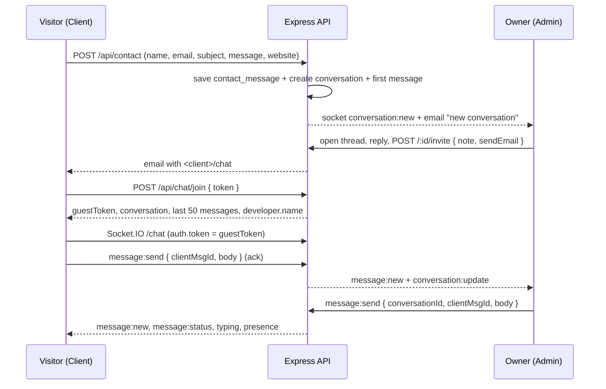

# Live chat

## Flow

## REST

Public (guest): `Authorization: Bearer <guestToken>` except `join`.

| Method | Path | Purpose |
|---|---|---|
| POST | `/api/chat/join` | Exchange invite token for a 24 h guest token |
| GET | `/api/chat/messages?before=<seq>&after=<seq>&limit=50` | History / catch-up |
| POST | `/api/chat/messages` | Send (fallback when the socket is down) |
| POST | `/api/chat/seen` | Read receipt |

Admin (cookie session + CSRF):

| Method | Path |
|---|---|
| GET | `/api/admin/conversations` (status, starred, isSpam, unread, q, page, pageSize) |
| GET | `/api/admin/conversations/unread-count` |
| GET | `/api/admin/conversations/:id` |
| GET | `/api/admin/conversations/:id/messages?before=&limit=` |
| POST | `/api/admin/conversations/:id/messages` |
| POST | `/api/admin/conversations/:id/read` |
| PATCH | `/api/admin/conversations/:id` (status, starred, isSpam) |
| DELETE | `/api/admin/conversations/:id` |
| POST | `/api/admin/conversations/:id/invite` |
| POST | `/api/admin/conversations/:id/invite/resend` |
| DELETE | `/api/admin/conversations/:id/invite` |

## Socket.IO events

Namespaces: `/admin` (httpOnly cookie + Origin check, revalidated every 60 s),
`/chat` (guest token + Origin check).

| Direction | Event | Payload |
|---|---|---|
| client→server | `message:send` | `{ conversationId?, clientMsgId, body }` + ack `{ ok, message?, error? }` |
| client→server | `typing` | `{ conversationId?, isTyping }` |
| client→server | `seen` | `{ conversationId?, upToSeq }` |
| admin→server | `conversation:view` / `conversation:leave` | `{ conversationId }` |
| server→both | `message:new` | `{ message }` |
| server→both | `message:status` | `{ conversationId, upToSeq, readAt? }` |
| server→both | `typing` | `{ conversationId, from: "visitor"\|"admin", isTyping }` |
| server→both | `presence` | `{ conversationId, visitorOnline, adminOnline, adminViewing }` |
| server→admins | `conversation:new` / `conversation:update` | `{ conversation }` / `{ id, patch }` |
| server→guest | `chat:closed` / `invite:revoked` | `{}` |
| server→any | `session:revoked` | `{}` |

Idempotency: `clientMsgId` (UUID) is unique per conversation; retries never
duplicate a message. Delivery is `delivered` when the other side's socket got it
and `read` when `seen` arrives.

## Email rules

| Recipient | Trigger | Throttle |
|---|---|---|
| Owner | Contact form / new conversation | Immediately, once per conversation |
| Owner | New visitor message while no admin socket is online or viewing | Max once per 10 min (`ownerEmailedAt`) |
| Visitor | Chat invite (optional note, join link, expiry, `Reply-To` owner) | Max 5 per hour per conversation |
| Visitor | New admin reply while the visitor is offline | Max once per 10 min (`visitorEmailedAt`), ≤200-char preview, fresh link only if the invite is still valid |

The contact form **never** emails the visitor. Mail is asynchronous with up to 3
retries and exponential backoff; a mail failure never fails a request. User
content is escaped in HTML.

## Invite lifecycle

1. 32 random bytes → base64url token. Only its SHA-256 hash is stored.
2. Link: `<client origin>/chat#t=<token>` — fragment, so it never reaches a
   server, log, or `Referer`. The page exchanges it, then removes it with
   `history.replaceState`.
3. Default lifetime 7 days. Resending rotates the token (old link dies).
4. Revoking sets `inviteRevokedAt`, disconnects the guest immediately, and the
   old link reports the revoked end-state.
5. `join` returns identical `404 INVITE_INVALID` for unknown/expired/revoked
   tokens; a closed conversation returns `410 CHAT_CLOSED`.
6. Guest JWT: `sub` = conversation id, `role: "guest"`, distinct audience,
   signed with the access secret, 24 h. Rejected as soon as the invite is
   revoked or the conversation is closed.

## Security model

- Admin HTTP + `/admin` socket are the authority; Admin route guards are UX only.
- Cookie session (`httpOnly`, `Secure`, `SameSite=Lax`), CSRF in memory only.
- Guest token scoped to one conversation: read, post, typing, seen. No owner
  email, no other conversations, no admin data.
- Message bodies: 1–2000 chars, trimmed, control characters stripped, blank
  lines collapsed, rendered as plain text. URLs are linkified only for
  `http(s)` with `rel="noopener noreferrer nofollow"`.
- Rate limits: guest 20/min and 300/day per conversation, admin 60/min, join
  20/hour per IP, invite mail 5/hour per conversation. Socket sends also use a
  per-socket token bucket.
- Bodies never appear in logs, URLs, or the audit log. Audit entries cover
  conversation created, invite sent/resent/revoked, close/reopen, delete, spam.
- Housekeeping: conversations idle 30 days auto-close; closed conversations are
  deleted after 90 days.
